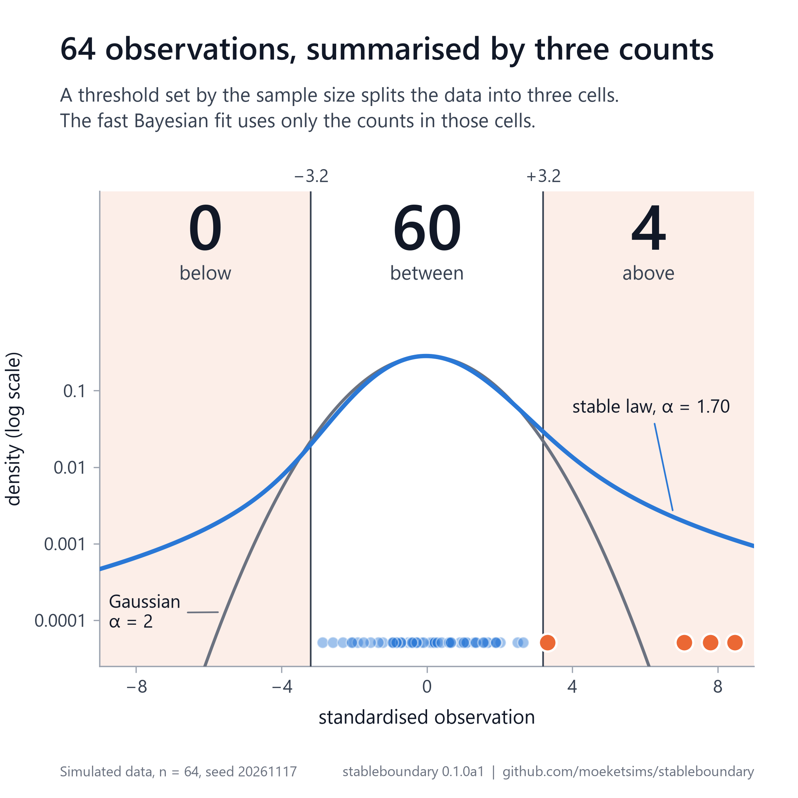
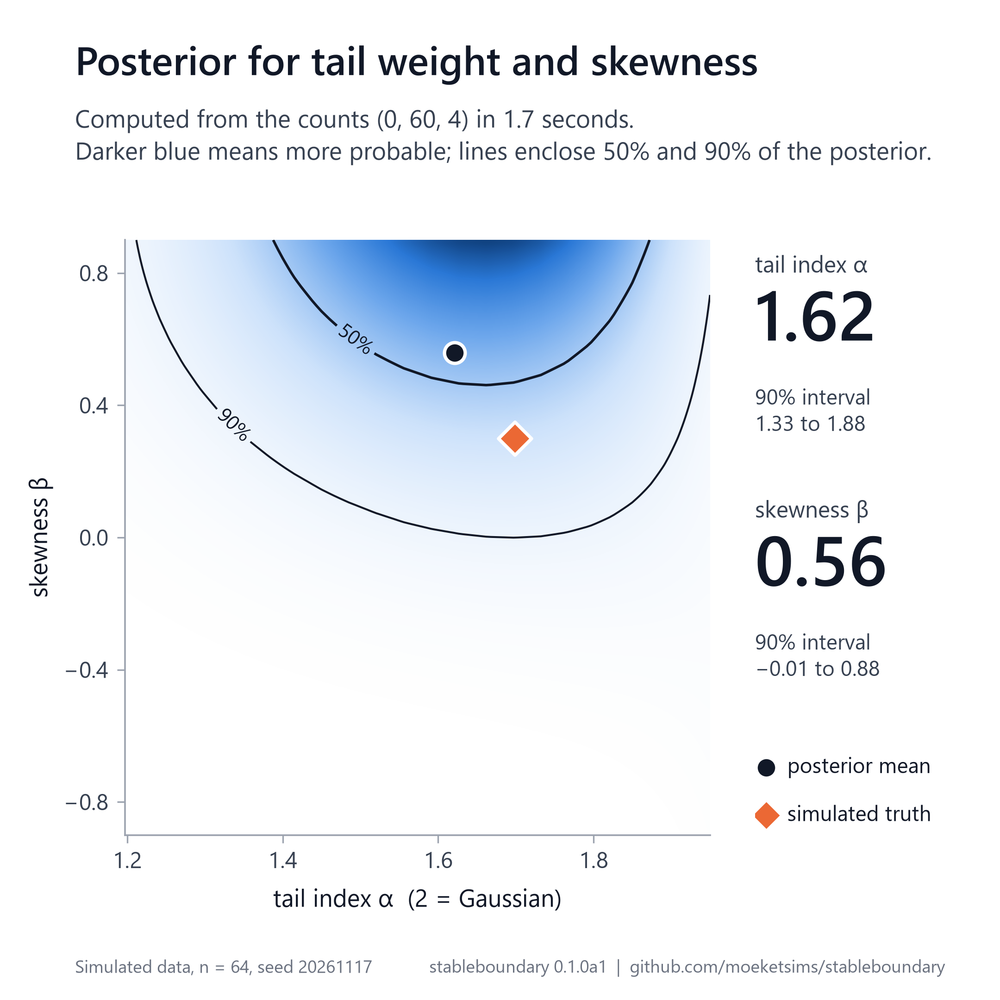
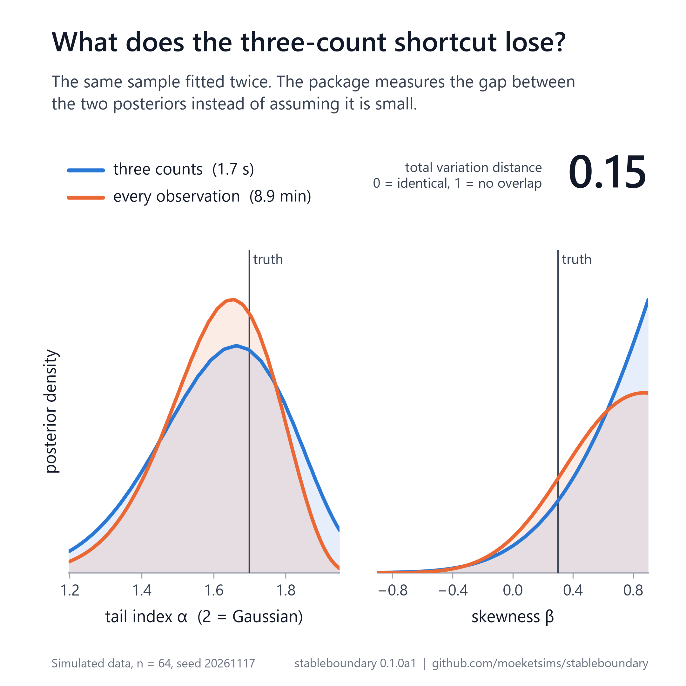

# stableboundary

**0.1.0a1: research alpha.** APIs may change before a stable release.
See the [release notes](https://github.com/moeketsims/stableboundary/blob/main/CHANGELOG.md)
and the [validation scope](https://github.com/moeketsims/stableboundary/blob/main/docs/validation.md).

`stableboundary` provides Bayesian inference for univariate alpha-stable laws
near the Gaussian boundary. Its first workflow fits the exact finite three-cell
posterior when location and scale are known independently of the observations.
All public parameters use Nolan's continuous `S0` parameterization.

## At a glance

One simulated sample of 64 observations (seed `20261117`, true `alpha = 1.70`,
`beta = 0.30`), fitted with this release. It is one illustrative example, not
evidence about the method in general. The data and scripts are in
[`figures/`](https://github.com/moeketsims/stableboundary/tree/main/figures).

<p align="center">
  
</p>

A threshold set by the sample size alone splits the observations into three
cells. The reduced fit uses only the three counts.

<p align="center">
  
</p>

The posterior from those counts, computed in under two seconds: tail index mean
1.62 (90% interval 1.33 to 1.88), skewness mean 0.56 (90% interval −0.01 to
0.88).

<p align="center">
  
</p>

The same sample fitted from every observation with `fit_full_known_nuisance()`,
and the two posteriors compared with `compare_posteriors()`: total variation
distance 0.15. Timings in the figure are from one Windows laptop and are not
benchmarks.

## Scientific scope

The current result status is always `research_uncertified`. The package does not
establish a mathematical certificate, make an automatic safe/fallback decision,
or estimate all four conventional stable parameters. It estimates the local
shape coordinates while treating the supplied `loc` and `scale` as externally
known. The finite-cell likelihood is exact for the declared three-cell model;
that description does not mean exact arithmetic or a finite-sample proof of the
reduction.

At the Gaussian boundary, `scale=1` in `S0` corresponds to a normal distribution
with standard deviation `sqrt(2)`, not standard deviation one. For every
supported posterior point `alpha < 2`, variance is infinite. Skewness can also
be weakly or not identified when signed-tail events are scarce; inspect the
structured identification diagnostics and warnings rather than reading a beta
interval in isolation.

## Installation

This alpha supports Python 3.12 through 3.14 and pins NumPy 2.5.2 and
SciPy 1.18.1. Use a separate virtual environment if another project needs
different versions. These pins deliberately limit the initial support claim.

Install the alpha from PyPI by naming the version, because pip skips
pre-releases by default:

```console
python -m pip install stableboundary==0.1.0a1
```

From a source checkout, install the package with:

```console
python -m pip install .
```

Released artifacts can instead be installed by passing the wheel or source
archive path to `python -m pip install`.

CI tests source archives in two deliberately distinct ways. The locked Linux
compatibility check creates a clean virtual environment, lets ordinary pip
resolve runtime dependencies and use its normal isolated PEP 517 build, runs
`pip check`, and imports `stableboundary` from outside the checkout. Separately,
the authenticated artifact smoke validates archive identity and integrity
before accepting its sdist-to-wheel execution path. The compatibility check is
evidence for the ordinary user install command; it is not a substitute for the
authenticated artifact proof.

## Audited known-nuisance fit

The executable artifact example separates inferential evidence from simulator
evidence. Its posterior is fitted to a deterministic 5000-observation witness
with signed-cell counts `(1, 4996, 3)`. Because the three-cell likelihood is
count-sufficient, the witness makes the inferential input transparent and keeps
it independent of changes to SciPy's random sampler. The example then runs a
separate fixed-seed `S0` simulation and reports the canonical little-endian raw
sample hash, five integer-quantized full-sample hashes, counts, extrema, summary
diagnostics, algorithms, and runtime versions. The source distribution includes
the example as `examples/known_nuisance_fit.py`. From a source checkout or an
unpacked source distribution, run:

```console
python examples/known_nuisance_fit.py
```

Wheel users do not need repository-only modules. After installing a wheel, save
the following as `quickstart.py` and run `python quickstart.py` from any working
directory:

```python
import json

import stableboundary as sb

n = 5_000
seed = 20_260_824
design = sb.LocalDesign.from_sample_size(n)
truth = sb.StableParams(
    alpha=2.0 - design.r * 1.5,
    beta=0.35,
    loc=0.0,
    scale=1.0,
)
observations = sb.simulate(truth, size=n, random_state=seed)
fit = sb.fit_known_nuisance(
    observations,
    loc=0.0,
    scale=1.0,
    design=design,
    prior=sb.LocalPrior.default(design),
    provenance="fixed by the simulation design",
    quadrature=sb.QuadratureConfig(
        base_nodes=20,
        refined_nodes=32,
        refinement_tolerance=0.002,
        common_grid_points=65,
    ),
)
print(json.dumps(fit.summary(), indent=2, sort_keys=True))
```

The output records `S0`, the fixed `loc` and `scale` with their provenance,
signed cell counts, and posterior summaries for `h`, `p`, `alpha`, `beta`,
`tau_plus`, and `tau_minus`. It also includes normalization and quadrature
refinement evidence, identification diagnostics, and warnings. The signed gaps
`tau_plus` and `tau_minus` are local shape coordinates, not threshold-free tail
probabilities.

The artifact smoke test accepts simulated evidence only for explicitly measured
operating-system, machine-architecture, NumPy, and SciPy combinations; an
unknown combination fails closed. The raw floating-point hash is diagnostic,
not normative: hosted CPUs and libm implementations can change insignificant
low bits. Acceptance instead uses the finest integer-quantization grid shown to
converge across independent hosts for that approved environment, together with
counts, extrema, and tolerance-bound summary diagnostics. Ordinary CI performs
two fresh isolated-interpreter simulations to detect process-state pollution.
A rejection prints the complete observed fingerprint so a maintainer can
review rather than blindly loosen the check. Posterior summaries are bound both
to retained regression values and to a higher-order reference generated
without importing `stableboundary`. These checks make the artifact reproducible
and sensitive to stale or hard-coded output, but they do not turn ordinary
floating-point calculations into a proof certificate.

## Full-likelihood reference and posterior comparison

`fit_full_known_nuisance()` evaluates the product of the individual S0 stable
densities under the same compact `(h, p)` prior as `fit_known_nuisance()`.
It retains observation magnitudes, including those inside the central cell.
It remains a local shape fit with independently known location and scale.

This small simulated example uses a prespecified, narrower local prior to keep
the reference calculation manageable:

```python
import json

import stableboundary as sb

design = sb.LocalDesign.from_sample_size(64)
prior = sb.LocalPrior(
    design,
    h_min=0.25,
    h_max=1.0,
    p_min=0.25,
    p_max=0.75,
)
truth = sb.StableParams(alpha=2.0 - design.r * 0.6, beta=0.2)
observations = sb.simulate(truth, size=design.n, random_state=20261116)
fit = sb.fit_known_nuisance(
    observations,
    loc=0.0,
    scale=1.0,
    design=design,
    prior=prior,
    provenance="simulation design",
)
full = sb.fit_full_known_nuisance(
    observations,
    loc=0.0,
    scale=1.0,
    design=design,
    prior=fit.prior,
    provenance=fit.nuisance.provenance,
)
comparison = sb.compare_posteriors(full, fit)
print(json.dumps(full.summary(), indent=2))
print(json.dumps(comparison.summary(), indent=2))
```

The full likelihood is a reference calculation and can be substantially slower
than the grouped likelihood. Work grows with the number of distinct observations
times the number of quadrature nodes. `observation_chunk_size` bounds the number
of distinct observations evaluated in a block; a further internal cap limits
temporary arrays. Exactly repeated values are evaluated once with their original
multiplicities. The package does not round or bin observations. The SciPy
backend does round: an observation within `0.005 * alpha**(1/alpha)` scale units
of `zeta = -beta * tan(pi * alpha / 2)` is evaluated at `zeta` (the recorded
`piecewise_x_tol_near_zeta` setting). `docs/validation.md` gives the measured
size of this effect. Start with a small sample when exploring runtime.

Both fitters check the base and refined quadrature grids, posterior summaries,
and design-tail predictions. A failed check raises `ConvergenceError`; increase
`base_nodes`, `refined_nodes`, and/or `common_grid_points` as indicated by the
diagnostic, rather than treating a failed fit as a successful result.

SciPy's stable routines are unreliable near `alpha = 1`. Both fitters therefore
refuse, with `ValidationError` and before any likelihood evaluation, a prior
whose support reaches `alpha < 1.10`, that is, one with
`2 - design.r * prior.h_max < 1.10`. With `c = 1` the default prior needs
`n >= 54`; otherwise pass a prior with the smaller `h_max` named in the error.
The full fit also refuses a sample whose largest standardized observation
exceeds `1e4` scale units, where the SciPy density loses accuracy. Both limits
are empirical cutoffs, not accuracy guarantees.

A `NumericalProbabilityError` means the calculation could not be completed
reliably. Investigate the reported input and numerical cause; increasing
quadrature nodes may change which points are evaluated, but does not establish
that the underlying backend problem is fixed. See "Known backend limits" in
`docs/validation.md`.

`compare_posteriors()` requires matching designs, priors, nuisance provenance,
and cell counts. Counts fully determine the reduced likelihood. It reports
total variation and Hellinger distances between the two normalized posteriors,
using shared interpolation grids of 65 and 129 points per axis by default.
Both distances lie in `[0, 1]`; Hellinger distance uses the convention
`sqrt(0.5 * integral((sqrt(p) - sqrt(q))**2))`. The comparison tolerance applies
to the change in these estimates when refining the grid, not to the size of
the disagreement between the posteriors. A large disagreement is a valid result.

These are observed-data diagnostics. Both fits share the SciPy S0 backend and
the deterministic posterior engine, so agreement is not independent numerical
validation, a prospective error bound, or an automatic safety decision.
The full fit's audit record includes the raw sample's canonical float64 SHA-256,
runtime versions, prior, nuisance provenance, and numerical controls. Raw
observations are not retained in the result. The raw-sample SHA-256 identifies
the ordered sample; it does not anonymise the data, and low-entropy samples may
be recoverable by guessing. Audit record layouts are method-specific and
experimental in this alpha: the full-fit and reduced-fit records carry the same
`schema_version` but are not one common shape. Its log normalizer includes the
raw-density scale Jacobian and cannot be compared with the grouped count
normalizer as a Bayes factor: the two likelihoods use different observation
spaces. Full-fit results currently expose parameter summaries and audit records;
the predictive convenience methods remain on the reduced-fit result.

## Maintainer checks

Run the checks in this order from the repository root:

```console
uv sync --extra dev --locked
uv run --frozen ruff check .
uv run --frozen ruff format --check .
uv run --frozen mypy
uv run --frozen coverage run --branch --source=stableboundary,scripts -m pytest -q -m "not installed"
uv run --frozen coverage run --branch --source=scripts --append scripts/generate_artifact_oracle.py --check scripts/artifact_oracle.json
uv run --frozen coverage report --include="src/stableboundary/*" --fail-under=80
uv run --frozen coverage report --include="scripts/*" --fail-under=80
uv run --frozen python -m build --no-isolation
uv run --frozen twine check dist/*
uv run --frozen check-wheel-contents dist/*.whl
uv run --frozen pytest -q tests/test_installed_package.py -m installed
```

The final test authenticates the wheel and source archive, explicitly builds
and inspects the sdist-derived wheel, installs each inspected wheel into a
separate clean virtual environment, and runs the same example from outside the
checkout. Locked Linux CI additionally installs the source archive through
ordinary isolated pip, including build isolation and dependency resolution, to
exercise the user-facing sdist path.

The oracle regeneration command independently evaluates the exact `S0`
three-cell likelihood with 48- and 64-node tensor Gauss--Legendre rules and
cross-checks selected cell probabilities by direct Gil--Pelaez Fourier
inversion. The generator imports NumPy and SciPy but is forbidden by test from
importing `stableboundary`. Review and explicitly approve any new
platform/architecture/NumPy/SciPy simulation key and its normative quantized
hash only after independent hosts agree and its counts, extrema, and summary
diagnostics have been checked. Raw hashes remain audit observations. The smoke
verifier intentionally rejects unmeasured combinations.

To exercise both archives with NumPy and SciPy pinned to the committed
`uv.lock`, run `uv run --frozen python -I -S scripts/smoke_wheel.py --locked-runtime`.
This optional mode retains the same artifact authentication and numerical
approval checks. The default smoke test resolves the same pinned runtime declared by the package.
It continues to refuse unapproved platform/runtime combinations.
Both modes also exercise the full-likelihood reference and posterior comparison
from each installed archive.

## Current limitations

- Input observations must be one-dimensional, finite, and independently drawn
  under the declared stable sampling model.
- Location and scale must be independently known; same-sample plug-in
  standardization is unsupported.
- With the SciPy backend, both fitters refuse a prior whose support reaches
  `alpha < 1.10`. With `c = 1` the default prior therefore needs `n >= 54`; a
  smaller `h_max` keeps a smaller sample in range.
- The full-likelihood fit refuses a sample whose largest standardized
  observation exceeds `1e4` scale units.
- Both of these limits are empirical cutoffs for the SciPy backend, not
  accuracy guarantees. See "Known backend limits" in `docs/validation.md`.
- The default fit is a reduced, exact finite-cell posterior. A separately
  requested full-likelihood reference and observed-data posterior comparison
  are available. Independent production numerics and automatic fallback remain
  future work.
- `research_uncertified` is deliberately retained even when ordinary
  floating-point refinement passes.
